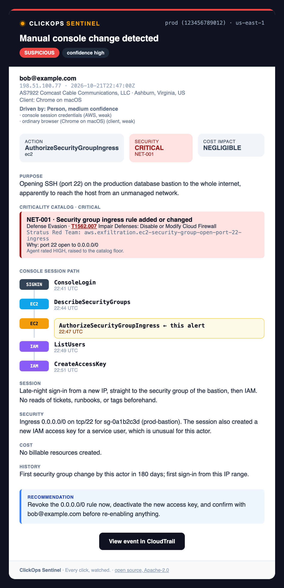
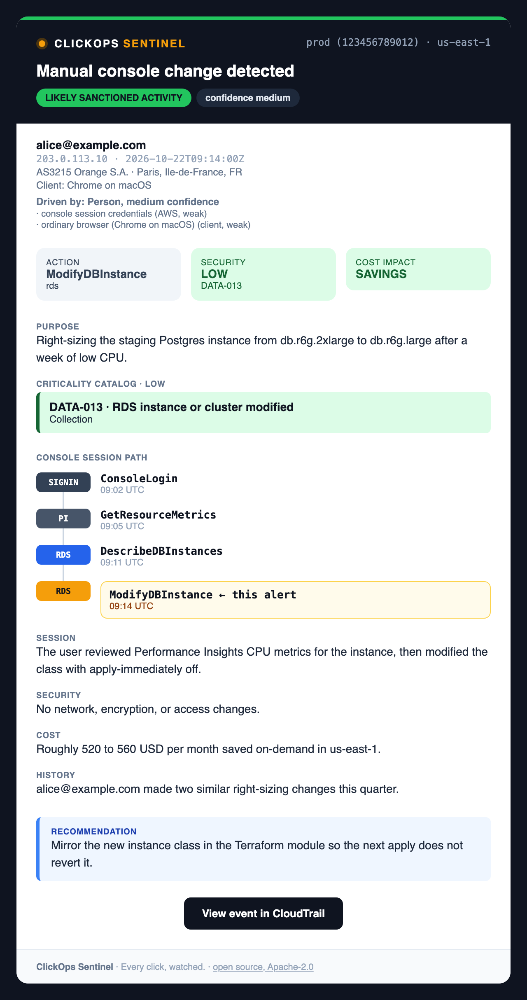
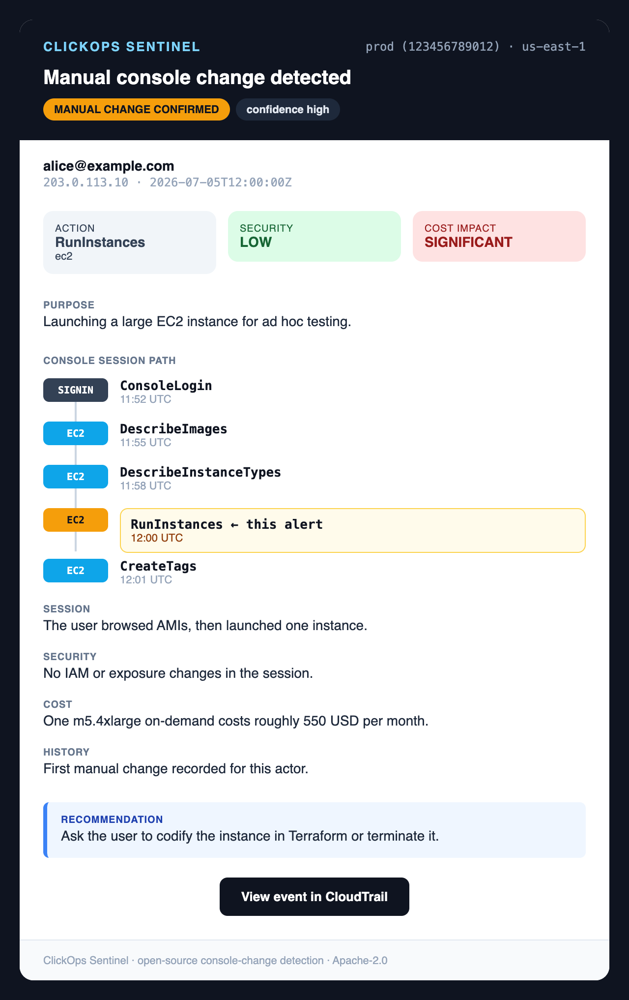
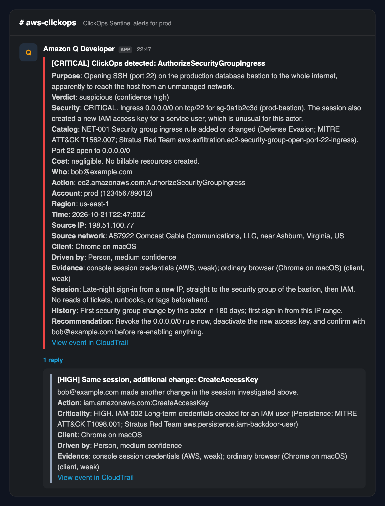
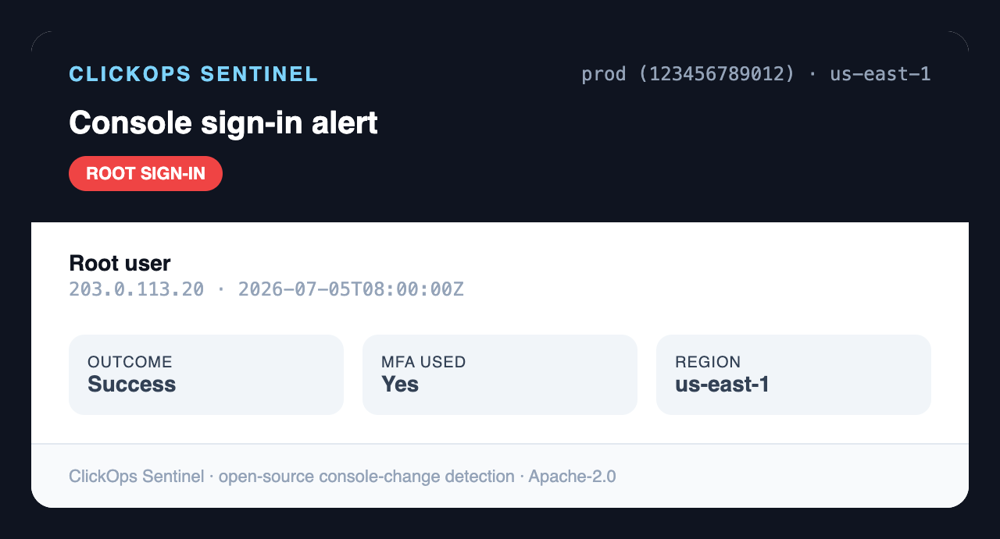
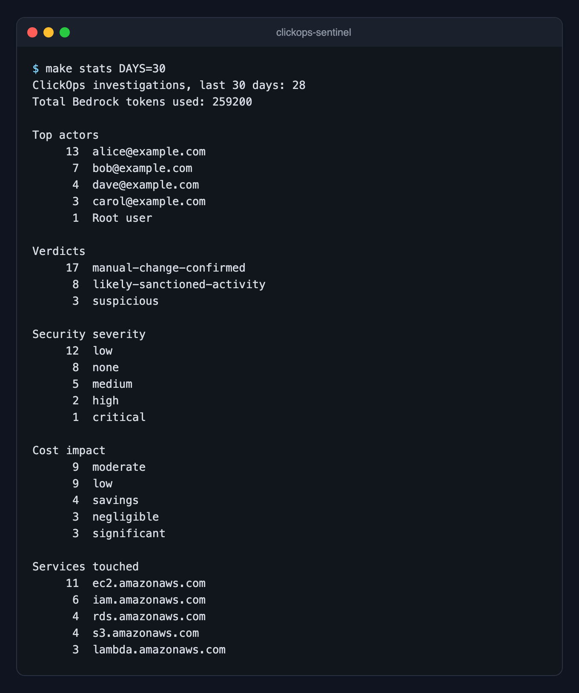
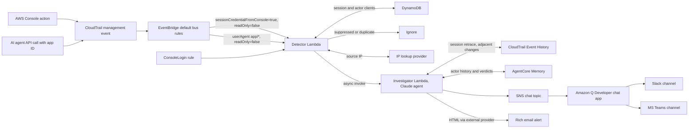

# ClickOps Sentinel

[](https://github.com/zoph-io/clickops-sentinel/actions/workflows/ci.yml)
[](LICENSE)
[](https://www.python.org/)

**Know within seconds when someone changes your AWS account by hand, and
why it matters.**

Someone opens the AWS Console and clicks a change into place: an SSH port
opened to the internet, an oversized instance for a quick test, a database
resized during an incident. Your infrastructure as code doesn't know it
happened, and CloudTrail only records it as one line among thousands.

ClickOps Sentinel catches every mutating console action in near real time,
has a Claude agent on Amazon Bedrock investigate it, and sends you a
reasoned alert: what the person was trying to do, what it means for security
and cost, what else they did in the same session, and what to do next.
It also catches AI agents changing infrastructure outside IaC, whether they
drive a browser in the console or call the API.

<p align="center">
  
</p>

## Why teams use it

- **Catch drift and risk as it happens.** Alerts arrive seconds after the
  click, not at the next `terraform plan` or quarterly audit.
- **Context, not just an event.** The agent retraces the whole console
  session, checks what else came from the same IP, and remembers each
  person's history ("first security group change by this actor in 180
  days"). You get a verdict and a recommendation instead of raw JSON.
- **Security and FinOps in one alert.** Each alert rates security severity
  (privilege escalation, public exposure, weakened defenses) and cost impact
  with a rough monthly dollar range, including savings.
- **A criticality scale you can audit.** Every change is rated against a
  published catalog of risky AWS actions (AWS Organizations changes, logging
  and detection tampering, credential backdoors, public exposure) mapped to
  MITRE ATT&CK and Stratus Red Team. The AI can raise a rating, never lower
  it, and critical changes are always investigated.
- **Know where the click came from.** The source IP is resolved to its
  network (ISP or hosting provider) and approximate location, with VPN,
  proxy, and Tor flags when available.
- **Catch AI agents and hijacked sessions.** Each alert says what made the
  call: a person's browser, a browser driven by an AI agent or automation,
  CloudShell, or a CLI labelled as an AI agent. API changes by labelled AI
  agents are alerted like console changes, and a session that switches
  browser or country mid-session is flagged as a likely stolen session.
- **Hard to evade from the console.** Console detection relies on a flag
  that AWS sets server-side on console credentials, not on user-agent
  strings, so spoofed user agents, role switching, and CloudShell are all
  still caught. The user agent only adds labels on top.
- **Cheap and light.** No CloudTrail trail, no S3 log bucket, no
  Kinesis. Two Lambdas, one DynamoDB table, and a hard daily Bedrock
  token budget. At typical volumes it costs well under one dollar per day.
- **Alerts always go out.** If Bedrock is down or the budget is spent, you
  still get a plain alert.
- **Open source**, Apache-2.0, deployed into your own account with AWS SAM.

## See it in action

The screenshots below are mock alerts rendered from the project's real email
and chat templates with sample data (`make preview-email` renders the email
templates locally).

**Not every alert is bad news.** The agent tells routine, sanctioned work
apart from real problems, and flags the money in both directions:

<table>
  <tr>
    <td width="50%" valign="top">
      
      <p align="center"><sub>Sanctioned right-sizing, flagged as savings, with a reminder to update Terraform</sub></p>
    </td>
    <td width="50%" valign="top">
      
      <p align="center"><sub>Ad hoc m5.4xlarge launch, flagged as a significant cost impact</sub></p>
    </td>
  </tr>
</table>

**Slack and Microsoft Teams**, through Amazon Q Developer in chat
applications. Later changes from the same console session are threaded under
the first alert, so one session doesn't flood the channel:

<p align="center">
  
</p>

**Console sign-in alerts** for root sign-ins, sign-ins without MFA, and
failed sign-ins:

<p align="center">
  
</p>

**An audit trail of manual changes.** Every investigation is recorded, so
you can see who works in the console, on which services, and how risky those
changes are:

<p align="center">
  
</p>

## Try it

You need an AWS account with the AWS SAM CLI, Python 3.13, and Bedrock
access to Anthropic Claude Sonnet 4.6, plus an API key from a supported
email provider (Resend by default). See [Prerequisites](#prerequisites) for
details.

```bash
git clone https://github.com/zoph-io/clickops-sentinel.git
cd clickops-sentinel
aws ssm put-parameter --name /clickops-sentinel/email-api-key \
  --type SecureString --value "re_your_api_key"
make install
make deploy-guided   # set NotificationEmail and EmailFrom, accept the other defaults
```

Then make a harmless change in the AWS Console, in the region you deployed
to, for example adding a tag to an SNS topic. A rich email alert should
arrive within a minute or two. To post to Slack or Teams instead of, or as
well as, email, see [Slack and Microsoft Teams setup](#slack-and-microsoft-teams-setup).

## How it works

1. **Detect.** CloudTrail emits every management write event to the
   EventBridge default bus, free of charge. A rule matches events where
   `sessionCredentialFromConsole` is true and `readOnly` is false, which
   means a mutating action made with console credentials. A second rule
   matches API write events whose user agent carries an app ID, for
   [AI agents](#clients-and-ai-agents) that label themselves.
2. **Filter and rate.** The detector Lambda drops known console noise,
   deduplicates (EventBridge delivers at least once), rates the change
   against the [criticality catalog](#criticality-scale-and-catalog), looks
   up the [source IP](#source-ip-enrichment), compares the
   [client](#clients-and-ai-agents) with the rest of the session and the
   actor's history, and starts at most one investigation per session every
   30 minutes. Critical changes and session anomalies skip that cooldown.
3. **Investigate.** The investigator Lambda runs a small Claude agent loop
   on the Bedrock Converse API. Using read-only tools, it replays the session
   from CloudTrail Event History, looks at adjacent activity from the same
   IP, and reads its long-term memory of the actor from Amazon Bedrock
   AgentCore Memory.
4. **Notify.** The structured verdict becomes a Slack or Teams message and a
   rich HTML email. The investigation is saved to DynamoDB and to memory,
   which shapes the next verdict about the same person.



Console detection relies on the CloudTrail `sessionCredentialFromConsole`
flag, which AWS sets server-side for every API call made with console
session credentials. The user agent is only used to label what made the
call and to catch AI agents that identify themselves. There is no CloudTrail
trail to create and no S3 log parsing: management write events arrive on the
EventBridge default bus at no cost, in seconds.

### What the agent reports

Each detection is investigated by a Claude agent before you are notified.
The agent retraces the whole console session through CloudTrail LookupEvents
(one temporary access key equals one session), checks adjacent activity from
the same IP, consults its long-term memory about the actor, and produces:

- a verdict (`manual-change-confirmed`, `likely-sanctioned-activity`,
  `suspicious`) with confidence
- a purpose assessment: what the user was apparently trying to accomplish
- security implications with a severity rating on the
  [criticality scale](#criticality-scale-and-catalog), never below the
  catalog floor: privilege escalation, public exposure, weakened defenses,
  secrets handling
- the matching catalog rule with its MITRE ATT&CK technique and Stratus Red
  Team reference
- the source network and approximate location, compared with the rest of
  the session and the actor's usual networks
- the client that made the call (browser, AI agent, automation, CloudShell),
  whether a human appears to have directed an AI agent, and any session
  anomaly such as a browser or country switch
- FinOps implications with a cost impact rating and rough monthly dollar
  range: instance launches, provisioned capacity, perpetual-billing
  resources, and also savings
- a session narrative and history context ("third manual security group
  change this month")
- a recommendation: import into IaC, revert, ask the user, or ignore

Delivery is guaranteed: if Bedrock is unavailable or the daily token budget
is spent, the alert still goes out on a plain, non-AI path, which keeps the
catalog rating and the source network.

### Criticality scale and catalog

Every change is rated on a five-level scale before the agent sees it, by a
deterministic catalog that needs no AI:

| Level | Meaning | Expected response |
| --- | --- | --- |
| critical | Disables audit logging or threat detection, changes the AWS Organization or its guardrails, grants administrator access or a cross-account backdoor, or exposes data publicly. | Act now: confirm with the actor and contain. |
| high | Creates credentials or privileges, weakens authentication, opens internet exposure, runs code or commands on existing resources, or destroys data without a recovery path. | Review the same day. |
| medium | Changes a security control with limited blast radius: private-range firewall rules, encryption or key state, backups and retention, account-scoped resource policies. | Review within the week. |
| low | Ordinary resource change with no exposure or privilege change. | Codify in IaC or revert during routine drift cleanup. |
| none | Cosmetic change only, such as tags or descriptions. | No action. |

The catalog maps about 80 rules covering 190 CloudTrail actions to a level, a
MITRE ATT&CK tactic and technique, and the matching
[Stratus Red Team](https://stratus-red-team.cloud/attack-techniques/AWS/)
attack technique. It covers AWS Organizations (leaving the organization,
detaching SCPs, delegated administrators), audit and detection tampering
(CloudTrail, Config, GuardDuty, Security Hub, flow logs), identity
backdoors (access keys, login profiles, trust policies, SAML providers,
Identity Center), data exposure (public snapshots, AMIs, bucket policies),
destruction (KMS key deletion, backups), and abuse patterns such as GPU
instance launches for cryptomining and Bedrock model access for LLMjacking.

How a rating is computed:

- Parameter checks read the request and raise the level. For example, a
  security group rule opened to `0.0.0.0/0` on SSH or a database port is
  critical, on another port high, and on a private range medium.
- Changes by the root user, and changes to ClickOps Sentinel's own
  resources, are rated at least high.
- Failed calls are lowered one level and marked as attempts.
- The rating is a floor. The agent may raise the severity from context (a
  chain of risky actions, an unusual network or country, a VPN or hosting
  source) but never lower it, and uses its verdict to say whether a risky
  change looks sanctioned.
- Critical changes bypass the session cooldown, so they are always
  investigated on their own. High and critical alerts carry the level in
  the email subject and chat title (`[CRITICAL] ClickOps detected: ...`)
  for filtering and routing.

The full referential is published in
[docs/criticality-catalog.md](docs/criticality-catalog.md), generated from
the code. Adapt it to your environment with `CriticalityOverrides`, for
example `ec2:CreateVpc=high,iam:CreateRole=low`. Parameter checks still
apply to overridden actions, so an override cannot hide a public exposure.

### Source IP enrichment

Alerts show who owns the source IP (ISP, corporate network, or hosting
provider, with its AS number) and its approximate location, plus VPN,
proxy, Tor, or hosting flags when the provider reports them. The agent uses
this to spot a session that changes country or network, or an actor working
from somewhere new. Console sign-in alerts are enriched too.

Lookups go to [ipinfo.io](https://ipinfo.io) over HTTPS, once per IP and
Lambda execution environment, with a 3 second timeout. Private addresses
and values such as `AWS Internal` are never sent. If the lookup fails, the
alert goes out without it. Location is city-level at best and can be off
for mobile and corporate networks.

- The unauthenticated tier is enough for typical alert volumes. For higher
  limits, or the privacy flags of paid plans, store an ipinfo token in SSM
  and set `IpLookupTokenParam`:

  ```bash
  aws ssm put-parameter --name /clickops-sentinel/ipinfo-token \
    --type SecureString --value "your_token"
  ```

- Source IPs are personal data in many jurisdictions. Set
  `IpLookupProvider=none` to keep them inside your account.

### Clients and AI agents

The CloudTrail `userAgent` tells what made each call. Alerts label it:

| Client | Example user agent | Label |
| --- | --- | --- |
| Browser | `... Chrome/156.0.0.0 Safari/537.36` | Chrome on macOS |
| AI agent browser | `... Cursor/3.27.6 Chrome/148... Electron/42.11.16 ...` | Cursor browser (AI agent tool) on macOS |
| Automated browser | `... HeadlessChrome/150.0.0.0 ...`, Playwright, Puppeteer, Selenium | Headless Chrome on Linux |
| AI agent via CLI or SDK | `aws-cli/2.38.5 ... app/cursor-agent ...` | AI agent cursor-agent via AWS CLI on macOS |
| CloudShell, IaC, CLI, SDK | `exec-env/CloudShell`, `Terraform/1.9.8`, `aws-sam-cli/1.169.0` | CloudShell, Terraform, AWS SAM CLI |

Changes by an AI agent are titled `ClickOps by an AI agent detected` (in the
console) or `AI agent change detected` (through the API), so they are easy
to filter and route.

**AI agents through the API.** Agents usually call the AWS CLI or an SDK,
which carries no console flag and looks exactly like a person typing. The
AWS CLI and SDKs add the value of `AWS_SDK_UA_APP_ID` to their user agent as
`app/<id>`, so set it in your agents' environments to make their changes
visible:

```bash
export AWS_SDK_UA_APP_ID=claude-code    # or cursor-agent, codex, kiro, ...
```

A second EventBridge rule forwards API write events carrying an app ID, and
the detector alerts on those matching `AgentAppIds` (by default common agent
names such as claude, cursor, codex, copilot, kiro, and any ID containing
`agent` or `mcp`). An AI agent changing infrastructure outside IaC is drift
like a console click, and gets the same investigation, rating, and alert.
An agent applying IaC (Terraform, SAM, CDK, Pulumi) is the path you want,
so it is attributed but not alerted. Set `WatchAgentApiChanges=false` to
watch the console only.

**Session anomalies.** The detector remembers the client and source country
of each session (one temporary access key) for 12 hours. When a session
switches from one browser to another, or changes country, between two
changes, the alert is raised to at least high by catalog rule SES-001 and
investigated even inside the session cooldown: it is the signature of a
stolen session cookie or temporary credentials replayed elsewhere. A switch
between the browser and CloudShell or a CLI is noted without raising the
level.

**New clients.** The detector also remembers, for `MemoryRetentionDays`,
which clients each person has used. A first change from a client never seen
for that person (Firefox on Windows for someone who always uses Chrome on a
Mac, or a sudden AI agent) is noted on the alert and given to the agent.

Know the limits: the user agent is self-reported. An agent marker is
evidence that an agent was involved, but an ordinary browser does not prove
a human: an agent driving a person's own browser looks exactly like them,
and an agent that does not set an app ID through the API is not seen.

### How ClickOps Sentinel compares

| | ClickOps Sentinel | Tools that parse CloudTrail logs in S3 |
| --- | --- | --- |
| Infrastructure needed | Nothing beyond the stack | A trail, log bucket access, cross-account KMS decrypt |
| Time to alert | Seconds | Minutes, after log delivery |
| Alert content | Verdict, purpose, security, cost, session, recommendation | Event details |
| Coverage model | One stack per region | Every region the trail covers |

The trade-off is the regional deployment model, described in
[Detection scope and trade-offs](#detection-scope-and-trade-offs). An example
of the S3 approach is the cloudandthings/terraform-aws-clickops-notifier
Terraform module.

## Prerequisites

- An AWS account with the AWS SAM CLI, Python 3.13, and GNU make installed
  locally.
- Bedrock model access: enable Anthropic Claude Sonnet 4.6 (or your chosen
  model) in the Bedrock console, in the region you deploy to. Current
  Anthropic models are invoked through cross-region inference profiles; the
  template composes the profile ID from `BedrockGeoPrefix` and
  `ClaudeModelId`.
- Amazon Bedrock AgentCore Memory availability in your region (used for
  long-term investigation memory; the stack deploys it via CloudFormation).
- For email delivery: an account at a supported email provider and the API
  key stored in SSM (see [Email setup](#email-setup)).
- For Slack or Microsoft Teams delivery: a one-time workspace authorization
  in the Amazon Q Developer console (see
  [Slack and Microsoft Teams setup](#slack-and-microsoft-teams-setup)). Not needed for email.

## Deploying

The [Try it](#try-it) steps above are the whole email deployment. When
`make deploy-guided` prompts you, set `NotificationEmail` to the recipient
address and `EmailFrom` to your verified sender, and accept the defaults
elsewhere. Later deployments reuse the saved answers in `samconfig.toml`:

```bash
make deploy
```

Deploy to us-east-1 at minimum, plus every region your team works in. See
[Detection scope and trade-offs](#detection-scope-and-trade-offs) for why.

## Email setup

Email alerts are full HTML: verdict and confidence pills, security and cost
cards, the agent's purpose and recommendation, and a console session path
diagram showing every step the user took, with the alerted action
highlighted.

Emails are sent through an external transactional email provider, not
Amazon SES (SES production access is deliberately out of scope). Supported
providers: [Resend](https://resend.com) (default),
[Postmark](https://postmarkapp.com), [Mailgun](https://www.mailgun.com),
[SendGrid](https://sendgrid.com), or any SMTP server for a fully
self-hosted path. The transport uses the Python standard library only.

One-time provider setup (Resend example):

1. Create a Resend account, verify your sending domain, and create an API
   key.
2. Store the key as an SSM SecureString in the deployment region:

```bash
aws ssm put-parameter \
  --name /clickops-sentinel/email-api-key \
  --type SecureString \
  --value "re_your_api_key"
```

3. Deploy with `NotificationEmail` (recipient) and `EmailFrom` (verified
   sender). The key is fetched with decryption at runtime and never appears
   in CloudFormation outputs or Lambda environment variables.

For SMTP, set `EmailProvider=smtp` plus `EmailSmtpHost`, `EmailSmtpPort`,
and `EmailSmtpUsername`, and store the SMTP password in the SSM parameter.
For Mailgun, also set `EmailMailgunDomain`.

Preview the templates locally without any AWS access:

```bash
make preview-email   # writes docs/email-preview.html
```

## Slack and Microsoft Teams setup

Chat delivery uses Amazon Q Developer in chat applications (formerly AWS
Chatbot). It renders the notifications natively and requires no webhook
management.

One-time workspace authorization (console, cannot be automated):

1. Open the Amazon Q Developer console, https://console.aws.amazon.com/chatbot/
2. Choose your chat client (Slack or Microsoft Teams) and authorize the
   workspace or tenant. For Slack, note the workspace ID; for Teams, note the
   team ID, channel ID, and tenant ID.
3. Invite the Amazon Q Developer app to the target channel.

Then redeploy with the IDs:

```bash
sam deploy --parameter-overrides \
  SlackWorkspaceId=T0123456789 SlackChannelId=C0123456789
```

or for Teams:

```bash
sam deploy --parameter-overrides \
  TeamsTeamId=... TeamsChannelId=... TeamsTenantId=...
```

Changes made by one console session are grouped into the same message thread.

## Configuration

| Parameter | Default | Description |
| --- | --- | --- |
| `NotificationEmail` | empty | Recipient address for email alerts. Empty disables email. |
| `EmailFrom` | empty | Verified sender address at your provider. Required for email. |
| `EmailProvider` | `resend` | `resend`, `postmark`, `mailgun`, `sendgrid`, or `smtp`. |
| `EmailApiKeyParam` | `/clickops-sentinel/email-api-key` | SSM SecureString parameter holding the provider API key or SMTP password. |
| `EmailSmtpHost` / `EmailSmtpPort` / `EmailSmtpUsername` | empty / `587` / empty | SMTP settings, only for `EmailProvider=smtp`. |
| `EmailMailgunDomain` | empty | Mailgun sending domain, only for `EmailProvider=mailgun`. |
| `SlackWorkspaceId` / `SlackChannelId` | empty | Slack channel via Amazon Q Developer. |
| `TeamsTeamId` / `TeamsChannelId` / `TeamsTenantId` | empty | Microsoft Teams channel via Amazon Q Developer. |
| `EnableConsoleLoginAlerts` | `true` | Alert on root sign-ins, sign-ins without MFA, failed sign-ins. |
| `EnableAIInvestigation` | `true` | Investigate detections with the Claude agent. `false` restores a plain notifier. |
| `ClaudeModelId` | `anthropic.claude-sonnet-4-6` | Bedrock model. Low-cost alternative: `anthropic.claude-haiku-4-5-20251001-v1:0`. |
| `BedrockGeoPrefix` | `us` | Inference profile geography: `us`, `eu`, `au`, `jp`, `global`. |
| `InvestigationLookbackHours` | `6` | Window for session retrace and same-IP correlation. |
| `DailyTokenBudget` | `2000000` | Hard daily cap on Bedrock tokens per UTC day. |
| `MaxAgentTurns` | `8` | Agent loop iterations per investigation. |
| `MemoryRetentionDays` | `180` | Retention for AgentCore Memory and investigation records. |
| `ExtraSuppressedActions` | empty | Comma-separated `service:Action` additions to the suppression list. |
| `CriticalityOverrides` | empty | Comma-separated `service:Action=level` re-ratings of the [criticality catalog](#criticality-scale-and-catalog). |
| `IpLookupProvider` | `ipinfo` | [Source IP enrichment](#source-ip-enrichment): `ipinfo` or `none`. |
| `IpLookupTokenParam` | empty | Optional SSM SecureString parameter holding an ipinfo.io token. |
| `WatchAgentApiChanges` | `true` | Also alert on API changes by [AI agents](#clients-and-ai-agents) that set an app ID. |
| `AgentAppIds` | common agent names | Comma-separated markers matched against app IDs and embedded browser apps. `*` treats every app ID as an agent. |
| `AccountFriendlyName` | empty | Account name in alerts. Empty resolves the IAM account alias. |
| `LambdaMemorySize` | `128` | Detector Lambda memory. |
| `PermissionsBoundaryArn` | empty | Permissions boundary applied to all created IAM roles. |

## Cost guardrails

Bedrock consumption is bounded by five layers, so a burst of console
activity cannot run up the bill:

1. Every model call caps `maxTokens`, and tool outputs are truncated before
   they enter the context.
2. Each investigation is limited to `MaxAgentTurns` iterations and roughly
   60k combined tokens; near the ceiling the agent must conclude with the
   evidence it has.
3. A DynamoDB atomic counter enforces `DailyTokenBudget` per UTC day. When
   spent, investigations stop and alerts continue on the plain path, with a
   one-time notice in the channel.
4. One investigation per console session per 30 minutes: follow-up changes
   in the same session are appended to the same chat thread as one-line
   notes.
5. Token usage is published as CloudWatch metrics (`ClickOpsSentinel`
   namespace), with an alarm at 80 percent of the daily budget. Consider an
   AWS Budgets alert on the Bedrock service as a backstop.

At typical volumes (a handful of investigations per day, Sonnet 4.6, a few
thousand tokens each), expect well under one dollar per day. Switch
`ClaudeModelId` to Haiku 4.5 to cut per-investigation cost further. Email
volume at these rates fits within the free tier of every supported provider.

## Statistics

Every investigation writes a structured record (actor, action, verdict,
purpose, security severity, catalog rule, source country and network,
client and AI agent, cost impact, tokens) to DynamoDB, retained for
`MemoryRetentionDays`. This is also a reviewable audit record of break-glass
console activity that can later be codified in IaC or reverted.

```bash
make stats DAYS=30
```

prints investigation counts, top actors, verdict and severity breakdowns,
catalog rules matched, source countries and networks, clients and AI
agents, cost impact distribution, and total token spend.

## Detection scope and trade-offs

What is covered: every mutating CloudTrail management event made with
console session credentials, in the deployed region, in near real time.
Because detection keys on a server-set credential flag, spoofed user agents
and new console user-agent variants cannot evade it, and role switching
inside the console remains detected.

Know the limits:

- Manual CLI and SDK actions are out of scope by design. A user running
  `aws ec2 run-instances` from a laptop is manual too, but carries no
  console flag. Catching that class requires federation conventions
  (session names set to emails) outside this tool's scope. The exception is
  AI agents that label themselves with an app ID (see
  [Clients and AI agents](#clients-and-ai-agents)).
- Data events (S3 object uploads, Lambda console test invokes, DynamoDB
  item edits) never reach the EventBridge default bus and are not detected.
- Read-only console browsing is not alerted on.
- Regional scope: management events arrive on the default bus of the region
  where the call happened. Deploy the stack to each region you use. Deploy
  to us-east-1 at minimum, since global services (IAM, CloudFront, Route 53)
  log there:

```bash
make deploy REGION=us-east-1
make deploy REGION=eu-west-1
```

- AWS CloudShell inherits console session credentials, so CloudShell CLI
  activity is flagged and alerted, which is usually what you want.
- No historical replay: without a trail, an event missed during an outage of
  the detector is not reprocessed (the 90-day CloudTrail Event History
  remains available for manual review; the DLQ captures failed deliveries).

## Architecture notes

- The agent is a deliberately small loop on the Bedrock Converse API (see
  `src/investigator/agent_loop.py`): no framework, exact token accounting,
  boto3 as the only dependency. If investigations ever need to exceed the 15
  minute Lambda limit, Amazon Bedrock AgentCore Runtime is the natural
  migration path.
- AgentCore Memory stores each investigation as a conversational event; the
  built-in semantic and summary strategies extract long-term records per
  actor, which the agent queries through its `get_actor_memory` tool.
- Deduplication (EventBridge is at-least-once), session cooldowns, the daily
  token budget, and investigation records share one pay-per-request DynamoDB
  table.
- Email is sent directly by the Lambdas through the external provider's
  HTTPS API (or SMTP), using only the Python standard library. Email
  failures are logged and never block the chat notification. The provider
  API key lives in an SSM SecureString parameter, fetched with decryption at
  runtime and cached per execution environment.
- Renaming note: this repository was previously published as
  `clickops-notifier`. The stack name, metrics namespace, and AgentCore
  Memory resource name changed with the rename; redeploying over an old
  stack replaces the memory store, which rebuilds over time.

## Troubleshooting

- No alerts arrive: check the detector Lambda logs (structured JSON, one
  decision line per event: `skipped`, `suppressed`, `deduplicated`,
  `investigating`, `notified`). Confirm you acted in the deployed region.
- Alerts arrive without AI sections: check the investigator Lambda logs.
  Common causes: Bedrock model access not enabled for the inference profile,
  daily token budget exhausted, or AgentCore Memory unavailable in the
  region (memory degrades gracefully, Bedrock access does not).
- No email arrives: check the Lambda logs for `email delivery failed`.
  Common causes: SSM parameter missing in the deployment region, sender
  domain not verified at the provider, or `EmailFrom` not set (email is
  only enabled when both `NotificationEmail` and `EmailFrom` are set).
- Slack or Teams silent: verify the workspace authorization in the Amazon Q
  Developer console and that the app is invited to the channel. Test by
  publishing a custom notification JSON to the chat topic from the SNS
  console.
- No source network in alerts: check the Lambda logs for `IP lookup
  failed`. Common causes: the event's source is not a public IP (for
  example `AWS Internal`), the provider's unauthenticated rate limit (set
  `IpLookupTokenParam`), or `IpLookupProvider=none`.
- An AI agent's API changes are not alerted: run one of its commands with
  `--debug` and check that the `User-Agent` header contains `app/<id>`, that
  the ID matches a marker in `AgentAppIds`, and that `WatchAgentApiChanges`
  is `true`. Read-only calls are never alerted.
- A rating that does not fit your environment: re-rate the action with
  `CriticalityOverrides`, and consider opening an issue if the default is
  wrong for everyone.
- Noisy action you want silenced: add `service:ActionName` to
  `ExtraSuppressedActions`, and consider opening an issue so it can join the
  default list.

## Development

```bash
make install        # venv plus dev dependencies
make lint           # ruff
make test           # pytest, no AWS credentials required
make validate       # sam validate --lint
make preview-email  # render the email templates to docs/email-preview.html
make catalog-doc    # regenerate docs/criticality-catalog.md after catalog edits
```

CI runs lint, tests, template validation, and a pip-audit dependency scan,
all credential-free. See [CONTRIBUTING.md](CONTRIBUTING.md) for guidelines,
[SECURITY.md](SECURITY.md) for vulnerability reporting, and
[CODE_OF_CONDUCT.md](CODE_OF_CONDUCT.md) for community standards.

## Future work

- Organization-wide deployment (org trail, StackSets, delegated admin).
- Session-name bypass detection for federated CLI access.
- Customizable message templates.
- Firehose or S3 sink for long-term alert archiving.

## License

Apache License 2.0. See [LICENSE](LICENSE).
